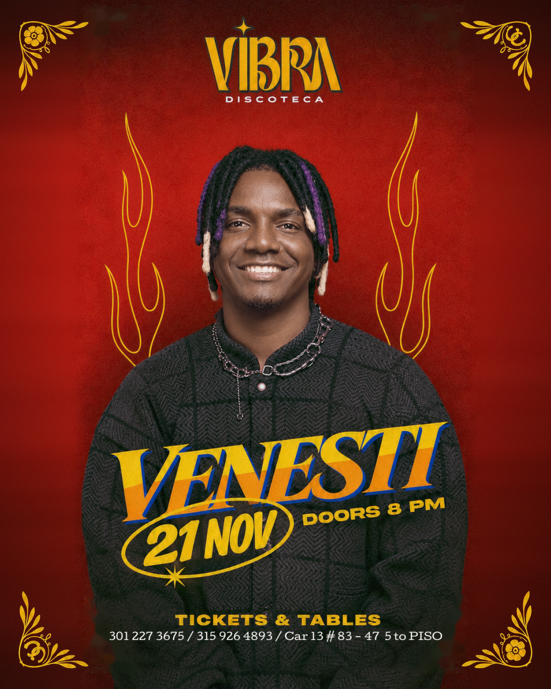

# VENESTI en VIBRA Discoteca — Landing Page Oficial

Landing page de una sola página, **mobile-first**, diseñada específicamente para la conversión de tráfico proveniente de Instagram (90%) para la venta de boletas y reservas de mesas VIP del concierto de **VENESTI** en **VIBRA Discoteca** (Bogotá).



## 📌 Datos del Evento
- **Artista:** VENESTI (en vivo con show completo)
- **Lugar:** VIBRA Discoteca — Cra 13 # 83-47, piso 5, Zona T, Bogotá
- **Fecha:** Sábado 21 de noviembre de 2026
- **Apertura de puertas:** 8:00 p. m.
- **Reservas e Información (WhatsApp):** 301 227 3675 | 315 926 4893
- **Eslogan:** *"La noche se vive, se siente y se vibra en VIBRA."*

## 🎨 Identidad Visual (Retro Glamour Latino)
- **Fondo:** Rojo carmesí profundo con viñeta oscura hacia los bordes (`#A3201A` → `#3A0806`) y textura sutil de ruido fotográfico (5%).
- **Acentos:** Dorado mostaza (`#E3A92B`) y brillo dorado (`#F5C542`).
- **Titular VENESTI:** Degradado amarillo `#F7C531` a naranja `#F08A1C` con relieve y contorno azul eléctrico `#1E46C8`.
- **Zonas:** Diamante fucsia (`#E2307C`), Oro dorado (`#F2B01E`) y Plata azul (`#1C4E9C`).
- **Paneles:** Fondo negro translúcido (`rgba(26, 5, 3, 0.88)`), desenfoque de fondo y resplandor naranja suave.

## 🚀 Características Principales
1. **Hero Fullscreen Mobile:** Optimizado a `100svh`, con cuenta regresiva en tiempo real al 21 nov 2026 (hora Bogotá, UTC-5) y botón CTA principal de compra con pulso interactivo.
2. **Mapa de Tarima Interactivo (SVG):** Visualización exacta de la tarima, 8 mesas Diamante frente al escenario, 11 mesas Oro (laterales y fila posterior), y bloques Plata. Al tocar cualquier mesa, se despliega la información y permite reservar de inmediato.
3. **Control Centralizado de Precios (`assets/js/config.js`):** Objeto JSON fácil de editar donde se definen precios, estados de mesas agotadas (`soldOut: true/false`), capacidades y teléfonos.
4. **Formulario Integrado con WhatsApp:** Mensaje prellenado según formato requerido, con selector de las dos líneas de atención oficiales (301 227 3675 y 315 926 4893).
5. **SEO & Rendimiento:** Etiquetas Open Graph con el flyer original, Twitter Cards, Schema.org JSON-LD para eventos musicales, imágenes en WebP y tiempos de carga instantáneos.

## 📁 Estructura del Proyecto
```text
├── index.html                  # Landing page principal
├── README.md                   # Documentación del proyecto
├── .gitignore                  # Exclusiones de control de versiones
├── assets/
│   ├── css/
│   │   └── styles.css          # Estilos oficiales y micro-animaciones
│   ├── js/
│   │   ├── config.js           # Configuración centralizada de precios y mesas
│   │   └── main.js             # Lógica interactiva (cuenta regresiva, mapa, WhatsApp)
│   └── images/                 # Activos optimizados (WebP, PNG y SVG)
└── venesti_vibra_feed_1.png    # Flyer oficial del evento
```
